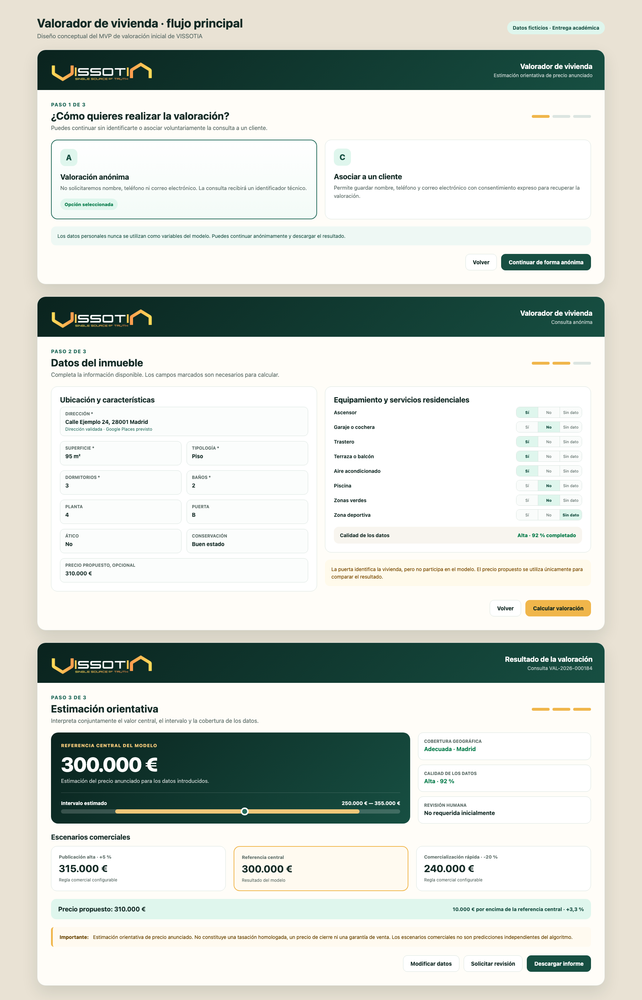

# Entrega 04 · Diseño del frontal y experiencia de usuario

## 1. Utilidad y valor del producto

El usuario principal es el profesional inmobiliario que necesita definir y justificar el precio inicial de publicación de una vivienda. En esta fase del proyecto no se pretende automatizar una tasación ni sustituir su experiencia, sino proporcionarle una referencia cuantitativa, trazable y comprensible antes de sacar el inmueble al mercado.

El problema que se aborda es la dificultad de establecer un precio de publicación coherente cuando la información está dispersa, los testigos de mercado no son completamente comparables o determinadas características del inmueble no están documentadas. Una estimación presentada como una cifra aislada podría generar una falsa sensación de precisión. Por ello, VISSOTIA mostrará conjuntamente el precio orientativo, un intervalo estimado, la cobertura disponible y la calidad de los datos introducidos.

El MVP de esta entrega se concentra en una única funcionalidad principal: la valoración inicial de una vivienda. El profesional introducirá la ubicación y las características del inmueble, revisará posibles datos ausentes y obtendrá:

- Un precio orientativo central de publicación.
- Un intervalo que represente la incertidumbre de la estimación.
- Una comparación con el precio que el profesional o el propietario plantean publicar.
- Un indicador de cobertura geográfica del modelo.
- Un indicador de calidad y completitud de los datos de entrada.
- Advertencias cuando la valoración requiera revisión humana.

A partir del resultado, el profesional podrá decidir si mantiene su precio propuesto, lo aproxima a la referencia calculada, modifica los datos del inmueble, guarda la valoración o solicita una revisión. La decisión final continuará siendo humana y deberá considerar información que el modelo todavía no representa, como la reforma, la calidad constructiva, las vistas, la situación documental o determinadas particularidades del mercado local.

El resultado se comunicará siempre como una estimación orientativa del precio anunciado. No representa el precio final de compraventa, una tasación homologada ni una garantía de cierre. Cuando la ubicación no tenga cobertura suficiente, los datos obligatorios estén incompletos o la incertidumbre sea excesiva, VISSOTIA no presentará la estimación como una recomendación concluyente.


## 2. Flujo de usuario

La valoración se plantea como una herramienta autónoma. No requiere que el inmueble exista previamente en la base de datos de VISSOTIA ni consulta sus expedientes. El usuario comienza con un formulario vacío y puede realizar la consulta de forma anónima o asociarla voluntariamente a sus datos de contacto.

El flujo principal se divide en ocho pasos:

1. **Elegir el tipo de consulta.** El usuario puede continuar anónimamente o identificar al cliente mediante nombre completo, teléfono y correo electrónico. Si decide guardar sus datos, deberá aceptar el correspondiente aviso de privacidad. La información personal no se utiliza como entrada del modelo.

2. **Localizar la vivienda.** El usuario comienza a escribir la dirección exacta. En el MVP final se prevé utilizar Google Places para sugerir coincidencias y obtener municipio, provincia, código postal y coordenadas. Si la dirección no aparece o el servicio no está disponible, podrá introducirse manualmente. La planta y la puerta se recogen por separado.

3. **Introducir las características.** El formulario solicita superficie, tipología, dormitorios, baños, planta, condición de ático y estado de conservación. También recoge ascensor, garaje, trastero, terraza o balcón, aire acondicionado, piscina, zonas verdes y zona deportiva. Los campos binarios permiten seleccionar `Sí`, `No` o `No informado`.

4. **Añadir el precio propuesto.** De manera opcional, el profesional puede indicar el precio que está considerando para la publicación. Este dato se emplea únicamente para comparar la propuesta con el resultado y no se utiliza como entrada del modelo.

5. **Revisar los datos.** Antes de calcular, la interfaz comprueba los campos obligatorios, identifica información ausente y muestra una valoración inicial de la calidad de los datos. Si falta información imprescindible, el cálculo permanece bloqueado y se explica cómo corregirla.

6. **Comprobar cobertura y calcular.** El sistema transforma la ubicación en las variables geográficas minimizadas utilizadas por el modelo y comprueba si existe cobertura suficiente. Cuando la ubicación queda fuera del ámbito validado, se informa al usuario y la consulta se deriva a revisión humana o se presenta con una advertencia reforzada.

7. **Interpretar el resultado.** La pantalla muestra la estimación central del precio anunciado, su intervalo de incertidumbre, la diferencia respecto al precio propuesto, la cobertura geográfica y la calidad de los datos. De forma separada muestra tres escenarios comerciales: publicación alta, referencia central y comercialización rápida.

8. **Elegir la acción posterior.** El usuario puede modificar los datos y repetir el cálculo, descargar el informe, guardar la valoración cuando haya aceptado la conservación de los datos o solicitar una revisión profesional.

Cada consulta recibe un identificador único `id_valoracion`. Cuando el usuario se identifica voluntariamente, la valoración puede relacionarse con un `id_cliente` y un `id_inmueble`. En una consulta anónima, `id_cliente` queda vacío y los datos personales no se solicitan.

El recorrido puede resumirse así:

```text
Acceder al valorador
→ Elegir valoración anónima o identificada
→ Localizar la vivienda
→ Completar características y equipamiento
→ Añadir precio propuesto, si existe
→ Revisar calidad y cobertura
→ Calcular la valoración
→ Interpretar estimación, intervalo y escenarios
→ Modificar, descargar, guardar o solicitar revisión
```

La estimación central procede del modelo de precio anunciado. Los escenarios de publicación alta, referencia central y comercialización rápida son reglas comerciales posteriores y configurables; no constituyen predicciones independientes del algoritmo ni garantías de venta. La Entrega 4 representa este comportamiento, pero no implementa todavía Google Places, la base de datos ni el servicio de predicción.


## 3. Diseño del frontal

El mockup representa el valorador como una experiencia autónoma formada por tres pantallas consecutivas. Mantiene la identidad visual de VISSOTIA mediante una cabecera verde oscura, fondos claros, tarjetas blancas y el color dorado como acento para la valoración. Los datos mostrados son ficticios y sirven únicamente para explicar la interfaz.

### Pantalla 1. Tipo de consulta

La primera pantalla permite elegir entre una valoración anónima y una valoración asociada voluntariamente a un cliente.

La opción anónima permite acceder directamente al formulario sin solicitar datos personales. La opción identificada despliega los campos de nombre completo, teléfono y correo electrónico, junto con el consentimiento necesario para conservarlos. Ninguno de estos datos participa en la predicción.

### Pantalla 2. Datos del inmueble

La segunda pantalla contiene el formulario principal, organizado en bloques para reducir la carga visual:

- **Ubicación:** dirección asistida mediante Google Places, introducción manual alternativa, planta y puerta.
- **Características:** superficie, tipología, dormitorios, baños, planta, condición de ático y conservación.
- **Equipamiento:** ascensor, garaje, trastero, terraza o balcón y aire acondicionado.
- **Servicios residenciales:** piscina, zonas verdes y zona deportiva.
- **Referencia profesional:** precio propuesto opcional.

Los campos binarios utilizan las opciones `Sí`, `No` y `No informado`. La pantalla muestra el grado de completitud, identifica los campos obligatorios y mantiene desactivado el cálculo mientras falte información imprescindible.

### Pantalla 3. Resultado de la valoración

La tercera pantalla prioriza la estimación central y la acompaña de información que permite interpretarla:

- Identificador único de la consulta.
- Precio orientativo central del modelo.
- Intervalo estimado de incertidumbre.
- Comparación con el precio propuesto.
- Cobertura geográfica.
- Calidad de los datos.
- Advertencias y necesidad de revisión humana.
- Acciones para modificar, descargar, guardar o solicitar revisión.

Los escenarios comerciales aparecen separados del intervalo estadístico. Para una estimación ficticia de 300.000 euros, el mockup muestra:

| Escenario | Cálculo | Importe |
| --- | ---: | ---: |
| Publicación alta | Estimación + 5 % | 315.000 € |
| Referencia central | Estimación del modelo | 300.000 € |
| Comercialización rápida | Estimación - 20 % | 240.000 € |

Los porcentajes son reglas de negocio configurables aplicadas después de la predicción. No son tres predicciones diferentes ni garantizan el precio o el plazo de venta.

El resultado mantiene visible la advertencia: «Estimación orientativa de precio anunciado. No constituye una tasación homologada, un precio de cierre ni una garantía de venta».



## 4. Experiencia de usuario

El diseño prioriza un recorrido breve, comprensible y progresivo. En lugar de mostrar toda la información simultáneamente, divide la experiencia en tres momentos: elección del tipo de consulta, introducción de los datos y presentación del resultado. Un indicador superior permite conocer en todo momento el paso actual.

La valoración anónima aparece como opción inicial para reducir fricción y evitar la recogida innecesaria de datos personales. La identificación del cliente es voluntaria y se explica que esos datos no participan en el modelo. Esta separación mantiene la coherencia con los criterios de minimización definidos en la preparación de datos.

El formulario agrupa los campos por significado: ubicación, características, equipamiento, servicios residenciales y precio propuesto. Los campos obligatorios están identificados y los controles binarios ofrecen `Sí`, `No` y `No informado`. De este modo, la interfaz no transforma una omisión en una respuesta negativa.

La dirección se plantea como un campo asistido por Google Places, acompañado de una alternativa manual. La planta y la puerta se solicitan separadamente porque no forman parte de la dirección normalizada. La puerta se utiliza para identificar la vivienda, pero no como variable predictiva.

El resultado utiliza una jerarquía visual clara. La estimación central ocupa la posición principal; el intervalo aparece inmediatamente debajo; y la cobertura, la calidad de los datos y la necesidad de revisión se muestran como información de contexto. Los escenarios comerciales se presentan en un bloque diferente para evitar que se interpreten como predicciones independientes.

La interfaz evita comunicar una falsa precisión. No muestra únicamente una cifra, sino también el intervalo de incertidumbre, la cobertura geográfica y las limitaciones de la valoración. Las advertencias utilizan texto explícito además del color, por lo que su significado no depende exclusivamente de elementos visuales.

Se contemplan los siguientes estados de error o incertidumbre:

- **Dirección no encontrada:** se ofrece introducción manual y confirmación de municipio y código postal.
- **Datos obligatorios incompletos:** el botón de cálculo permanece desactivado y se señalan los campos pendientes.
- **Cobertura geográfica insuficiente:** no se presenta el resultado como recomendación concluyente y se propone revisión humana.
- **Intervalo excesivamente amplio:** se explica que la estimación tiene baja precisión y se solicitan datos adicionales.
- **Datos contradictorios o fuera de rango:** se pide revisar superficie, dormitorios, baños, planta o precio propuesto.
- **Modelo no disponible:** se conserva el formulario y se ofrece reintentar más tarde sin mostrar un valor inventado.
- **Resultado singular:** se destaca la necesidad de revisión profesional antes de utilizar la estimación.

Las acciones posteriores mantienen una prioridad coherente: descargar el informe es la acción principal, mientras que modificar los datos y solicitar revisión permanecen accesibles como alternativas. En una evolución funcional se añadirán navegación mediante teclado, etiquetas accesibles, contraste suficiente y mensajes asociados directamente a cada campo.

## 5. Continuidad hacia el MVP final

La Entrega 4 define el diseño y el comportamiento esperado, pero no implementa todavía el frontal, la base de datos ni la conexión con el modelo. Para la presentación final se desarrollará una primera versión funcional y separada del repositorio de producción de VISSOTIA.

### Elementos previstos para el MVP funcional

- Valorador accesible como herramienta autónoma.
- Posibilidad de realizar una valoración anónima.
- Identificación voluntaria del cliente con consentimiento.
- Autocompletado de dirección mediante el componente de Google Places ya desarrollado en VISSOTIA, manteniendo una alternativa manual.
- Formulario con las variables autorizadas en las entregas de datos y Machine Learning.
- Validación de campos obligatorios, rangos y valores desconocidos.
- Conexión con un servicio de predicción mediante una API.
- Presentación del precio orientativo central, intervalo, cobertura y calidad de los datos.
- Comparación con el precio propuesto por el profesional.
- Cálculo separado de los escenarios comerciales de publicación alta, referencia central y comercialización rápida.
- Generación de un identificador para cada valoración.
- Descarga de un informe con los datos, la versión del modelo y las advertencias.

La interfaz no decidirá por sí sola qué modelo debe utilizarse. Consumirá la versión aprobada para el ámbito geográfico correspondiente. El modelo entrenado con abril continúa siendo la referencia académica para Madrid, Sevilla y Córdoba; el modelo reentrenado con las ocho ciudades permanece como candidato hasta validarlo con una captura futura independiente.

### Conexión con los datos y el modelo

El flujo técnico previsto será:

```text
Formulario del usuario
→ Validación y normalización
→ Geocodificación y minimización de la ubicación
→ Contrato de entrada del modelo
→ Servicio de predicción
→ Estimación, intervalo, cobertura y versión
→ Reglas comerciales posteriores
→ Presentación y descarga del resultado
```

La dirección exacta permitirá localizar el inmueble, pero el modelo utilizará las variables geográficas derivadas definidas en la Entrega 2. Los datos personales permanecerán separados de las variables predictivas.

Cuando el usuario acepte guardar la consulta, la persistencia se organizará mediante tres entidades relacionadas:

```text
CLIENTES 1 ─── N INMUEBLES
INMUEBLES 1 ─── N VALORACIONES
```

Una valoración anónima conservará su `id_valoracion`, pero no tendrá asociado un `id_cliente`.

El servicio devolverá, como mínimo, la estimación central, el intervalo, la fecha, la versión del modelo, la cobertura geográfica, la calidad de la entrada y la necesidad de revisión humana. Los porcentajes comerciales del +5 % y -20 % se aplicarán fuera del modelo y quedarán identificados como reglas configurables.

### Mejoras posteriores

Quedarán fuera del alcance inmediato:

- Integración completa con la base de datos operativa de VISSOTIA.
- Recuperación automática de datos de Catastro.
- Incorporación de indicadores del INE y servicios próximos.
- Comparación visual con testigos de mercado.
- Uso de información de reforma, año de construcción, eficiencia energética, vistas o calidad constructiva.
- Modelo específico de seguimiento comercial con demanda y días publicados.
- Entrenamiento con precios efectivos de cierre cuando exista una fuente autorizada.
- Registro y promoción automatizada de modelos mediante MLflow.
- Despliegue reproducible con Docker, réplicas y balanceo de carga.
- Integración con los asistentes y chatbots de VISSOTIA.
- Adaptación completa para dispositivos móviles.

Estas capacidades podrán incorporarse posteriormente al TFM final para mostrar la evolución global de VISSOTIA. Su inclusión futura no modifica el alcance de esta entrega, centrada en diseñar una experiencia comprensible para la valoración inicial.
